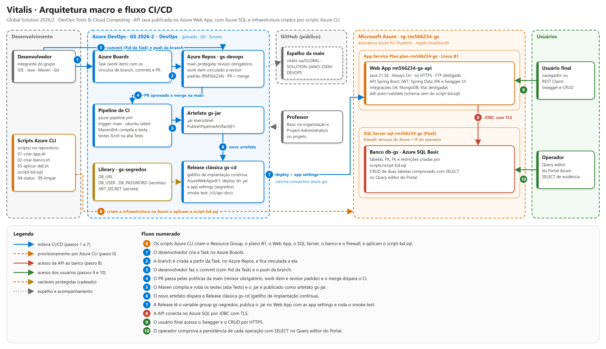

# Vitalis · API de lembretes de medicação com CI/CD no Azure DevOps 💊

Este repositório é a entrega de **DevOps Tools & Cloud Computing** da **Global Solution 2026/2** (FIAP, 2º ano de ADS) do grupo **Vitalis**. Ele leva a API Java da solução do grupo, uma plataforma de lembretes de medicação para idosos, para uma esteira de CI/CD no **Azure DevOps**:

- a infraestrutura em nuvem (Web App e banco **Azure SQL**) é criada por **scripts Azure CLI** versionados em [`scripts/`](scripts/);
- o código vive no **Azure Repos**, com a branch `main` protegida, e cada mudança nasce de uma Task do **Azure Boards** e entra por pull request;
- cada merge na `main` dispara o **CI**, que compila, roda os testes automatizados e publica o artefato;
- cada novo artefato dispara a **Release**, que faz o deploy automático no **Azure Web App**.

> O código-fonte em [`src/`](src/) é um snapshot da API da disciplina Java Advanced, adaptado para o Azure SQL. ⏳ PENDENTE (src): repositório e commit de origem do snapshot.

---

## 👥 Integrantes

| RM | Nome completo | Turma |
|:---:|:---|:---:|
| RM561489 | Ana Flávia Camelo | 2TDSPV |
| RM562745 | Gustavo Kenji Terada | 2TDSPV |
| RM566234 | João Guilherme Carvalho Novaes | 2TDSPV |
| RM565154 | Pedro Chasci Puga | 2TDSPV |
| RM561342 | Lucas Figueiredo Vieira | 2TDSPV |

## 🔗 Links da entrega

| Item | Link |
|---|---|
| Projeto no Azure DevOps | https://dev.azure.com/RM565154/GS%202026-2%20-%20DevOps |
| Azure Repos (origem do código) | https://dev.azure.com/RM565154/GS%202026-2%20-%20DevOps/_git/gs-devops |
| Espelho público no GitHub | https://github.com/vitalis-sa/GLOBAL-SOLUTION-2ANO-2SEM-DEVOPS |
| Vídeo no YouTube | ⏳ PENDENTE: link do vídeo |
| API publicada (Swagger UI) | https://rm566234-gs-api.azurewebsites.net/swagger-ui.html |

---

## 1. 📝 Descrição da solução

Idosos que usam vários medicamentos ao mesmo tempo esquecem doses, tomam a mesma dose duas vezes ou confundem horários, e quem cuida deles normalmente só descobre a falha depois que ela teve consequência. A solução do grupo Vitalis é uma plataforma de lembretes de medicação: no horário de cada dose, o idoso recebe um lembrete e registra um check-in, e familiares e profissionais de saúde são avisados quando uma dose não é confirmada.

| Ator | Papel |
|---|---|
| Idoso | Recebe os lembretes e faz o check-in de cada dose |
| Familiar | Acompanha a adesão e é alertado quando uma dose não é confirmada |
| Profissional de saúde ou cuidador | Cadastra ou revisa medicamentos e horários e recebe alertas |

A solução atende principalmente ao **ODS 3 (Saúde e bem-estar)**, porque atua sobre a adesão ao tratamento, e ao **ODS 10 (Redução das desigualdades)**, porque amplia a autonomia de um público que costuma ficar à margem das soluções digitais. Todos os dados usados em testes, exemplos e vídeo são sintéticos, já que dados de saúde são dados pessoais sensíveis pela LGPD.

Nesta entrega, o que passa pela esteira e vai para a nuvem é a **API Java** com autenticação JWT e CRUD sobre o banco relacional. As integrações da API (IA generativa, MongoDB e mensageria) não são configuradas neste deploy: sem elas, a API sobe e o CRUD funciona normalmente.

### Stack

| Camada | Tecnologia |
|---|---|
| Aplicação | Java 21 e Spring Boot (Spring Web, Spring Security com JWT, Bean Validation, springdoc-openapi). ⏳ PENDENTE (src): versões do snapshot |
| Persistência | Spring Data JPA (Hibernate) com o driver `mssql-jdbc`; o Hibernate só valida o schema (`ddl-auto=validate`) |
| Banco de dados em nuvem | **Azure SQL Database** (PaaS), plano Basic, criado por Azure CLI |
| Build e testes | Maven (wrapper `mvnw`), JUnit 5. ⏳ PENDENTE (src): quantidade de testes |
| Planejamento | **Azure Boards** (processo Scrum) |
| Versionamento | **Azure Repos** (origem, `main` protegida) e espelho público no GitHub |
| CI/CD | **Azure Pipelines**: CI em YAML ([`azure-pipeline.yml`](azure-pipeline.yml)), CD em Release clássica e Library (variable group protegido) |
| Nuvem | **Azure App Service**: Web App Linux, Java 21 SE, plano B1, região Brazil South |
| Infraestrutura como script | **Azure CLI** em bash ([`scripts/`](scripts/)) e `sqlcmd` para o DDL |

---

## 2. 🏗️ Arquitetura macro e fluxo CI/CD



> Versão vetorial: [`docs/arquitetura-devops.svg`](docs/arquitetura-devops.svg).

Fluxo numerado (os mesmos números do desenho):

0. Os **scripts Azure CLI** criam o Resource Group, o plano B1, o Web App, o SQL Server, o banco e o firewall, e aplicam o [`script-bd.sql`](scripts/script-bd.sql).
1. O desenvolvedor cria a **Task** no Azure Boards.
2. A **branch** é criada a partir da Task, no Azure Repos, e fica vinculada a ela.
3. O desenvolvedor faz o **commit** (com `#id` da Task) e o push da branch.
4. O **pull request** passa pelas políticas da `main` (revisor obrigatório, work item vinculado e revisor padrão), e o merge dispara o CI.
5. O Maven **compila e roda os testes** (aba Tests), e o `.jar` é publicado como artefato **`gs-jar`**.
6. O novo artefato dispara a **Release clássica `gs-cd`** (gatilho de implantação contínua).
7. A Release lê o variable group **`gs-segredos`**, publica o `.jar` no Web App com as app settings e roda o **smoke test**.
8. A API conecta no **Azure SQL** por JDBC com TLS.
9. O usuário final acessa o **Swagger** e o CRUD por HTTPS.
10. O operador comprova a persistência de cada operação com **`SELECT`** no Query editor do Portal Azure.

| Ferramenta | Onde atua | Passos |
|---|---|---|
| Azure CLI + `sqlcmd` | Provisionamento da infraestrutura e do schema | 0 |
| Azure Boards | Tasks vinculadas a branches, commits e PRs | 1–2 |
| Azure Repos | Código, branches, políticas da `main` e pull requests | 2–4 |
| Azure Pipelines (CI) | Build, testes e artefato | 4–5 |
| Azure Releases (CD) | Deploy automático no Web App e smoke test | 6–7 |
| Azure DevOps Library | Variable group com os segredos protegidos | 7 |
| Azure App Service (Web App) | Hospeda a API Java 21 | 7–9 |
| Azure SQL Database | Banco de dados em nuvem | 8, 10 |
| GitHub | Espelho público da `main` | — |

---

## 3. ☁️ Infraestrutura criada por script (Azure CLI)

Todos os recursos de nuvem são criados pelos scripts de [`scripts/`](scripts/), e o Build e a Release usam esses recursos.

| Recurso | Nome | Configuração | Script |
|---|---|---|---|
| Resource Group | `rg-rm566234-gs` | `brazilsouth` | `01-criar-app.sh` |
| App Service Plan | `plan-rm566234-gs` | Linux, B1 | `01-criar-app.sh` |
| Web App | `rm566234-gs-api` | Java 21 SE, Always On, só HTTPS, FTP desligado, logs em arquivo | `01-criar-app.sh` |
| SQL Server | `sql-rm566234-gs` | TLS mínimo 1.2 | `02-criar-banco.sh` |
| Banco | `db-gs` | Azure SQL, plano Basic (5 DTU) | `02-criar-banco.sh` |
| Firewall | `AllowAzureServices` e `operador` | Libera o Web App e o IP de quem roda o script | `02-criar-banco.sh` |
| Tabelas | ver [`script-bd.sql`](scripts/script-bd.sql) | PK, FK e restrições | `03-aplicar-ddl.sh` |

| Script | O que faz |
|---|---|
| [`00-variaveis.sh`](scripts/00-variaveis.sh) | Nomes dos recursos e região, centralizados e sem segredos (carregado com `source` pelos demais) |
| [`01-criar-app.sh`](scripts/01-criar-app.sh) | Cria o Resource Group, o plano B1 e o Web App, e aplica a configuração geral |
| [`02-criar-banco.sh`](scripts/02-criar-banco.sh) | Cria o SQL Server, o banco e as regras de firewall |
| [`03-aplicar-ddl.sh`](scripts/03-aplicar-ddl.sh) | Executa o `script-bd.sql` no banco com `sqlcmd` |
| [`04-status.sh`](scripts/04-status.sh) | Mostra o estado do Web App, testa a API publicada e lista as tabelas (só leitura) |
| [`99-limpar.sh`](scripts/99-limpar.sh) | Apaga o Resource Group inteiro, com confirmação |

Os scripts podem ser executados de novo: recursos existentes são mantidos, e a regra `operador` é atualizada com o IP atual. A assinatura Azure for Students só permite as regiões `southafricanorth`, `brazilsouth`, `spaincentral`, `chilecentral` e `eastus`; a escolhida é `brazilsouth`.

---

## 4. 🗄️ Banco de dados em nuvem

O banco é um **Azure SQL Database**, serviço PaaS aceito pelo enunciado, criado pelo script [`02-criar-banco.sh`](scripts/02-criar-banco.sh) no plano Basic. O plano Basic foi escolhido em vez da oferta gratuita serverless porque a oferta gratuita pausa o banco quando a cota mensal acaba, o que deixaria a API fora do ar durante a correção.

- O DDL de todos os objetos está em [`scripts/script-bd.sql`](scripts/script-bd.sql), aplicado por [`03-aplicar-ddl.sh`](scripts/03-aplicar-ddl.sh).
- A aplicação não cria nem altera tabelas: o Hibernate só confere se as entidades batem com o banco (`ddl-auto=validate`).
- O snapshot da disciplina Java Advanced usa Oracle. Nesta entrega, o driver e o DDL foram convertidos para o SQL Server, sem mudar as regras de negócio.

⏳ PENDENTE (src): lista das tabelas e relacionamentos.

---

## 5. ⚙️ Projeto no Azure DevOps

| Campo | Valor |
|---|---|
| Organização | `RM565154` |
| Project name | `GS 2026-2 - DevOps` |
| Description | Projeto da Global Solution 2026/2 (DevOps Tools & Cloud Computing) do professor João Menk, com os integrantes RM, nome e turma |
| Visibility | Private |
| Version control | Git |
| Work item process | Scrum |

**Acesso do professor:** o professor João Menk tem nível de acesso **Basic** na organização (Organization Settings › Users) e está no grupo **Project Administrators** do projeto (Project Settings › Permissions).

---

## 6. 📋 Azure Boards e Azure Repos

O trabalho é planejado no Azure Boards e cada mudança no código fica rastreável até a Task que a originou.

| Work item | Tipo | Título |
|---|---|---|
| 302 | Product Backlog Item | Implantar a API na nuvem com CI/CD |
| 303 | Task (tarefa inicial) | Importar o snapshot do Java para o Azure Repos |
| 304 | Task | Provisionar a infraestrutura por Azure CLI |
| 305 | Task | Adaptar o snapshot para Azure SQL |
| 306 | Task | Criar o pipeline de CI |
| 307 | Task | Criar a Release de CD |
| 308 | Task | Documentar o README e a arquitetura |

Fluxo de trabalho de cada mudança:

1. A Task é criada no Boards.
2. A branch é criada a partir da própria Task (*Create branch*), o que já cria o vínculo.
3. Os commits citam a Task com `#id` na mensagem.
4. O pull request para a `main` é vinculado à Task, aprovado e mesclado.
5. A Task mostra, na seção *Development*, a branch, os commits, o PR e o build.

### Políticas da branch `main`

| Política (Branch policies) | Configuração |
|---|---|
| Require a minimum number of reviewers | 1 revisor, com *Allow requestors to approve their own changes* (o aluno pode aprovar o próprio PR) |
| Check for linked work items | Required: todo PR precisa de work item vinculado |
| Automatically included reviewers | RM566234 como revisor padrão obrigatório |

Com as políticas ativas, ninguém faz push direto na `main`: o único caminho é o merge de um PR, e é esse merge que dispara o CI. A `main` é espelhada no GitHub público depois de cada merge.

---

## 7. 🚀 Pipelines CI/CD

### CI: build, testes e artefato ([`azure-pipeline.yml`](azure-pipeline.yml))

Pipeline YAML `gs-ci`, ligada ao repositório `gs-devops` do Azure Repos. Ela dispara a cada commit na `main` (`trigger: main`) e não roda em PR (`pr: none`).

| Task | O que faz |
|---|---|
| `Maven@4` (`clean package`) | Compila com JDK 21, **roda os testes automatizados** e empacota o `.jar` |
| ↳ `publishJUnitResults` | Publica os relatórios JUnit (`surefire-reports`) na aba **Tests** |
| `CopyFiles@2` | Separa o `.jar` executável em `$(Build.ArtifactStagingDirectory)` |
| `PublishPipelineArtifact@1` | **Publica o artefato `gs-jar`** no Azure DevOps |

| Variável da pipeline | Valor |
|---|---|
| `artefato` | `gs-jar` |
| `opcoesMaven` | `-B -DexcludedGroups=integracao` |

Os testes que precisam do banco têm a tag JUnit `integracao` e ficam de fora no CI, de modo que nenhuma credencial chega ao agente de build. ⏳ PENDENTE (src): quantidade de testes e de classes executadas no CI.

### CD: deploy automático (Release clássica `gs-cd`)

| Configuração | Valor |
|---|---|
| Artefato | Build da pipeline `gs-ci`, alias `_gs-ci`, versão padrão *Latest* |
| Gatilho | **Continuous deployment trigger** ligado, com filtro de branch `main`: cada artefato novo cria uma release |
| Stage | `Produção (Azure Web App)`, agente `ubuntu-latest` |
| Task 1 | **Azure Web App** (`AzureWebApp@1`): service connection `azure-gs`, tipo *Web App on Linux*, app `rm566234-gs-api`, pacote `$(System.DefaultWorkingDirectory)/_gs-ci/gs-jar/*.jar`, runtime `JAVA\|21-java21` |
| App settings | `-DB_URL "$(DB_URL)" -DB_USER "$(DB_USER)" -DB_PASSWORD "$(DB_PASSWORD)" -JWT_SECRET "$(JWT_SECRET)" -SERVER_PORT 80` |
| Task 2 | **Bash** (smoke test): espera a API responder antes de dar a release como concluída |
| Variáveis | Variable group `gs-segredos` vinculado à release |

Script do smoke test (Task 2):

```bash
URL="https://rm566234-gs-api.azurewebsites.net/v3/api-docs"
for tentativa in $(seq 1 20); do
  if curl -s --max-time 20 "$URL" | grep -q '"openapi"'; then
    echo "API no ar (tentativa $tentativa)"; exit 0
  fi
  echo "Tentativa $tentativa: a API ainda está subindo..."; sleep 15
done
echo "##vso[task.logissue type=error]A API não respondeu em $URL"; exit 1
```

---

## 8. ✅ Requisitos do enunciado e como foram atendidos

| # | Requisito | Como foi atendido |
|:---:|---|---|
| 01 | Projeto privado e com Git | Projeto `GS 2026-2 - DevOps`, privado, Git, processo Scrum (seção 5) |
| 02 | Azure Boards vinculado ao Repos | Branches criadas a partir das Tasks, commits com `#id` e PRs vinculados (seção 6) |
| 03 | Branch principal protegida | Revisor obrigatório, work item vinculado e revisor padrão (RM566234) na `main` |
| 04 | Build somente após merge na main via PR | `trigger: main` e `pr: none`; as políticas impedem push direto na `main` |
| 05 | O aluno pode aprovar o próprio PR | *Allow requestors to approve their own changes* ligado |
| 06 | Release automática após novo artefato | Continuous deployment trigger da Release `gs-cd` no artefato `gs-jar` |
| 07 | Deploy em container ou Serviço de Aplicativo | Serviço de Aplicativo: Web App Linux `rm566234-gs-api` (Java 21 SE) |
| 08 | Banco em container ou PaaS | PaaS: Azure SQL `db-gs`, criado por script |
| 09 | Scripts de infraestrutura no repositório | [`scripts/`](scripts/) |
| 10 | `script-bd.sql` com o DDL em `/scripts` | [`scripts/script-bd.sql`](scripts/script-bd.sql) |
| 11 | Scripts Azure CLI em `/scripts` | [`scripts/00-variaveis.sh`](scripts/00-variaveis.sh) a [`scripts/99-limpar.sh`](scripts/99-limpar.sh) |
| 12 | Dockerfiles em `/dockerfiles` (caso use Docker) | Não se aplica: a solução não usa Docker (deploy do `.jar` no Web App e banco PaaS) |
| 13 | `azure-pipeline.yml` na raiz | [`azure-pipeline.yml`](azure-pipeline.yml) |
| 14 | CRUD exposto em JSON no README (APIs sem Swagger) | A API tem Swagger e, mesmo assim, os JSON do CRUD estão na seção 11 e em [`docs/demo-crud.http`](docs/demo-crud.http) |
| 15 | Variáveis de ambiente nas pipelines | Variáveis no YAML do CI e variable group `gs-segredos` na Release, gravado como app settings no Web App |
| 16 | Desenho macro da arquitetura | Seção 2 |
| 17 | Testes automáticos no CI | `Maven@4` roda os testes e publica os resultados JUnit na aba Tests |

---

## 9. 🔒 Variáveis de ambiente e segurança

| Variável | Sensível | Onde fica |
|---|:---:|---|
| `DB_URL` | não | Variable group `gs-segredos` → app setting do Web App |
| `DB_USER` | sim | Variable group `gs-segredos` (secret) → app setting do Web App |
| `DB_PASSWORD` | sim | Variable group `gs-segredos` (secret) → app setting do Web App |
| `JWT_SECRET` | sim | Variable group `gs-segredos` (secret, ≥ 32 caracteres) → app setting do Web App |
| `SERVER_PORT` | não | `80`, a porta que o App Service Linux encaminha para a aplicação (gravada por `01-criar-app.sh`) |

- **Nenhuma credencial** está no código, no YAML, nos scripts ou no histórico. Localmente, as variáveis vêm de um `.env`, ignorado pelo Git; o [`.env.example`](.env.example) lista quais existem, sem valores.
- Os scripts leem o login e a senha do banco do ambiente, e o `sqlcmd` recebe a senha pela variável `SQLCMDPASSWORD`, e não pela linha de comando.
- O Web App aceita só HTTPS e tem o FTP desligado, e o SQL Server exige TLS 1.2 e só aceita conexões do Azure e do IP do operador.

---

## 10. 💻 How-to: reproduzir a solução

### Pré-requisitos

- [Git](https://git-scm.com/) e **JDK 21** (o Maven vem no wrapper `mvnw`)
- [Azure CLI](https://learn.microsoft.com/pt-br/cli/azure/install-azure-cli), com `az login` feito na assinatura
- [`sqlcmd`](https://learn.microsoft.com/pt-br/sql/tools/sqlcmd/sqlcmd-utility) (`winget install Microsoft.Sqlcmd`)
- Uma organização no Azure DevOps com parallel jobs hospedados liberados

### 1. Clonar e configurar as variáveis

```bash
git clone https://dev.azure.com/RM565154/GS%202026-2%20-%20DevOps/_git/gs-devops
cd gs-devops
cp .env.example .env          # preencha DB_USER, DB_PASSWORD e JWT_SECRET
set -a; source .env; set +a   # exporta as variáveis para os scripts
```

### 2. Criar a infraestrutura na Azure

Os scripts **criam recursos pagos**.

```bash
bash scripts/01-criar-app.sh     # Resource Group, plano B1 e Web App Java 21
bash scripts/02-criar-banco.sh   # SQL Server, banco Basic e firewall (imprime a DB_URL)
bash scripts/03-aplicar-ddl.sh   # tabelas do script-bd.sql
bash scripts/04-status.sh        # estado do Web App, da API e do banco (só leitura)
```

Copie a `DB_URL` impressa pelo `02-criar-banco.sh` para o `.env`.

### 3. Configurar o Azure DevOps

1. Crie o projeto (privado, Git, Scrum), convide o professor com acesso **Basic** e coloque-o em **Project Administrators**.
2. Importe este repositório em **Repos** e configure as políticas da `main` (seção 6).
3. Em **Project settings › Service connections**, crie a conexão **Azure Resource Manager** `azure-gs` com acesso ao Resource Group `rg-rm566234-gs`.
4. Em **Pipelines › Library**, crie o variable group `gs-segredos` com `DB_URL`, `DB_USER`, `DB_PASSWORD` e `JWT_SECRET`, clicando no **cadeado** das três últimas.
5. Em **Pipelines › New pipeline**, escolha *Azure Repos Git* › `gs-devops` › *Existing Azure Pipelines YAML file* › `/azure-pipeline.yml`, e renomeie para `gs-ci`.
6. Em **Releases › New › Empty job**, crie a `gs-cd` como na seção 7. Se o menu Releases não aparecer, desligue *Disable creation of classic release pipelines* em Organization Settings › Pipelines › Settings e nas configurações do projeto.
7. Crie uma Task no Boards, uma branch a partir dela, faça um commit e um PR para a `main`. O merge dispara o CI, o CI dispara a Release, e `bash scripts/04-status.sh` confirma que a API está no ar.

### 4. Rodar e testar localmente (opcional)

```bash
./mvnw -B clean package -DexcludedGroups=integracao   # o mesmo comando do CI (não precisa de banco)
./mvnw spring-boot:run                                # com as variáveis do .env exportadas
```

No Windows, `.\run.ps1` carrega o `.env`, avisa se faltar variável obrigatória e sobe a aplicação. O IP da máquina precisa estar liberado no firewall do banco (rode de novo `02-criar-banco.sh`).

### 5. Limpeza (depois da correção)

```bash
bash scripts/99-limpar.sh        # apaga o Resource Group inteiro (pede confirmação)
```

---

## 11. 🧪 Demonstração do CRUD com evidência no banco

O CRUD é feito pelo Swagger UI da API publicada e, depois de cada operação, um `SELECT` no Query editor do Portal Azure mostra a persistência no Azure SQL. As duas tabelas da demonstração não dependem uma da outra nem de serviço externo. As chamadas estão em [`docs/demo-crud.http`](docs/demo-crud.http) (extensão *REST Client* do VS Code) e os `SELECT` em [`docs/consultas-video.sql`](docs/consultas-video.sql).

| Passo | Chamada | Evidência no Azure SQL |
|---|---|---|
| 0 | Autenticação: cria o operador da demo e devolve o token JWT | — |
| 1.1 a 1.4 | `POST`, `GET`, `PUT` e `DELETE` na Tabela 1 | A linha aparece, muda e some no `SELECT` |
| 2.1 a 2.4 | O mesmo ciclo na Tabela 2 | A linha aparece, muda e some no `SELECT` |

⏳ PENDENTE (src): nomes das duas tabelas, rotas e os corpos JSON de cada operação.

Para usar o Swagger UI:

1. Abra https://rm566234-gs-api.azurewebsites.net/swagger-ui.html.
2. Execute a rota de autenticação e copie o `token`.
3. Clique em **Authorize** e cole o token.
4. A partir daí, todo *Try it out* já envia o cabeçalho `Authorization`.

---

## 12. 📁 Estrutura do repositório

```
.
├── azure-pipeline.yml        → CI: build, testes, resultados JUnit e artefato gs-jar
├── scripts/
│   ├── 00-variaveis.sh       → nomes dos recursos e região (sem segredos)
│   ├── 01-criar-app.sh       → Resource Group, plano B1 e Web App
│   ├── 02-criar-banco.sh     → SQL Server, banco e firewall
│   ├── 03-aplicar-ddl.sh     → executa o script-bd.sql
│   ├── 04-status.sh          → estado do Web App, da API e do banco
│   ├── 99-limpar.sh          → apaga o Resource Group
│   └── script-bd.sql         → DDL dos objetos do banco (T-SQL)
├── docs/
│   ├── arquitetura-devops.png / .svg   → desenho macro da arquitetura
│   ├── demo-crud.http        → roteiro do CRUD contra a API publicada
│   └── consultas-video.sql   → SELECT de evidência de cada operação
├── src/                      → código-fonte da API Java (snapshot)
├── pom.xml · mvnw · .mvn/    → build Maven
├── .env.example              → modelo das variáveis de ambiente, sem valores
├── run.ps1                   → carrega o .env e sobe a API localmente
├── .gitattributes            → LF em scripts e YAML
└── .gitignore
```

---

## 🤖 Declaração de uso de IA

O grupo usou o Claude (Claude Code) como apoio para escrever os scripts Azure CLI, o pipeline de CI, o desenho da arquitetura e este README, a partir da entrega de DevOps da Sprint 4 do Challenge. Todo o conteúdo foi revisado pelo grupo, e cada integrante consegue explicar a esteira, os scripts e as decisões de arquitetura.
